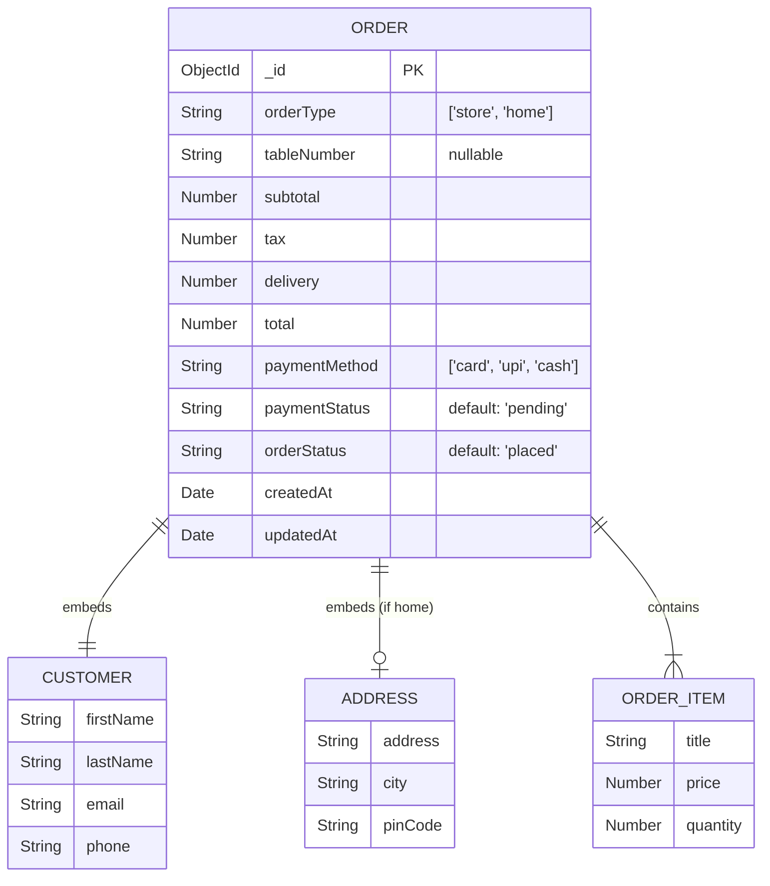

# ☕ Brew Umber

> **Brew Umber** is a modern, full-stack MERN application crafted for specialty coffee shops and artisanal roasteries. It delivers an end-to-end digital café experience—from real-time coffee discovery and persistent cart management to dynamic dine-in/takeaway checkout, multi-channel payment handling, and automated email order dispatching.

---

## Table of Contents

- [1. Project Title \& Overview](#1-project-title--overview)
- [2. Core Features](#2-core-features)
- [3. Tech Stack](#3-tech-stack)
- [4. Database Models](#4-database-models)
- [5. API Reference](#5-api-reference)
- [6. Authentication \& Security](#6-authentication--security)
- [7. Environment Variables](#7-environment-variables)
- [8. Local Setup \& Execution](#8-local-setup--execution)
- [Folder Structure](#folder-structure)
- [License](#license)

---

## 1. Project Title & Overview

**Brew Umber** is a full-stack digital ordering and café management web application built with the **MERN** stack (MongoDB, Express.js, React 19, Node.js) and powered by Vite and Tailwind CSS.

### Problem It Solves
Artisanal cafes and roasteries often face operational bottlenecks when managing high-volume on-premise orders alongside off-premise deliveries. Traditional point-of-sale systems or third-party aggregator apps charge steep commissions, disconnect the customer from the brand aesthetic, and fail to cater to hybrid dining scenarios (such as table-side ordering vs. doorstep delivery).

### Primary Use Case
Brew Umber resolves these challenges by offering a unified, high-performance web platform that allows customers to:
1. Browse real-time artisanal hot and iced coffee menus with transparent pricing and flavor notes.
2. Maintain persistent shopping carts that survive page refreshes and synchronize seamlessly across browser tabs.
3. Choose flexibly between **"At Store"** (table service with designated table numbering) and **"At Home"** (delivery with complete address validation and automatic delivery surcharge computation).
4. Pay through multiple supported channels: **UPI QR Code** scanning, **Credit/Debit Card**, or **Cash on Delivery**.
5. Receive instant, automated order confirmation emails powered by an integrated backend SMTP notification engine.

---

## 2. Core Features

### 🛍️ User-Facing Capabilities
- **Artisanal Coffee Catalog & Live Ingestion**:
  - Dynamically fetches hot and cold brew selections from external coffee data streams (`api.sampleapis.com/coffee`).
  - Employs deterministic hashing algorithms (`priceFor`) to ensure consistent, item-level pricing across reloads and cart sessions.
  - High-resolution visual cards with fallback image handling and ingredient descriptions.
- **Cross-Tab Synchronized Persistent Cart**:
  - Built with React Context API and backed by browser `localStorage` (`brew-umber-cart`).
  - Active listening via `window.addEventListener('storage')` to mirror cart updates instantly across multiple open tabs.
  - Real-time item counters, price computations, and intuitive quantity increasers/decreasers.
- **Dynamic Dual-Fulfillment Checkout**:
  - **At Store (Dine-In / Store Pickup)**: Dedicated table number assignment to enable baristas to deliver directly to customer seats.
  - **At Home (Doorstep Delivery)**: Captures street address, city, and PIN code; automatically adds standard delivery surcharges (₹30).
  - Dynamic invoice calculation including subtotal, configurable tax (5% GST), and total breakdown.
- **Multi-Channel Payment Options**:
  - **UPI QR Code Integration**: In-app QR code display (`/qr.jpeg`), step-by-step instructions for Google Pay / PhonePe / Paytm / BHIM, and explicit payment confirmation checkboxes.
  - **Card Payments**: Input validation for card numbers, MM/YY expiry dates, and CVV.
  - **Cash on Delivery (COD)**: Supports pay-on-arrival workflows with appropriate transaction status tracking.
- **Café Storytelling & Interactive Touchpoints**:
  - Brand landing hero section with an embedded artisanal brewing video background.
  - Rich "About Us" section driven by modular JSON data (`rest.json`) showcasing ethical sourcing, sustainability metrics, and small-batch roasting standards.
  - Client-side validated contact form with real-time feedback states.

### ⚙️ Backend & Infrastructure Capabilities
- **RESTful Order Ingestion Engine**:
  - Express.js API designed to validate and persist orders to MongoDB Atlas via Mongoose.
  - Clean separation of concerns across models, utility modules, and route controllers.
- **Automated Email Dispatch System**:
  - Integrated Nodemailer service configured with secure Gmail SMTP (`smtp.gmail.com:465`).
  - Dispatches personalized order receipts containing the generated MongoDB Order ID, line item summary, and gross total upon successful creation.
- **Resilient Client-Server Communication**:
  - Client-side custom response parsing (`readJsonResponse`) guarding against non-JSON server error dumps (such as cold-start timeouts or HTML 404/502 pages).
  - CORS-enabled server endpoints for distributed deployments (e.g., frontend on Vercel/Netlify, backend on Render).

---

## 3. Tech Stack

### Frontend
| Technology | Version / Category | Purpose |
| :--- | :--- | :--- |
| **React** | `v19.2.7` | Declarative UI component library |
| **Vite** | `v8.1.1` | Next-generation frontend bundler and development server |
| **React Router DOM** | `v7.18.4` | Client-side declarative routing and navigation |
| **Tailwind CSS** | `v4.3.3` (`@tailwindcss/vite`) | Utility-first responsive design framework |
| **Context API** | Native React | Global shopping cart and persistent application state |
| **Redux Toolkit** | `^2.12.0` (`@reduxjs/toolkit`, `react-redux`) | Installed for enterprise global state management extensions |
| **Remix Icon** | `v4.9.1` (`remixicon`) | Vector icon system for user actions, cart, and payment logos |

### Backend
| Technology | Version / Category | Purpose |
| :--- | :--- | :--- |
| **Node.js** | `v18+` (Recommended) | Server-side JavaScript runtime environment |
| **Express.js** | `v5.2.1` | Minimalist HTTP web framework for REST API routing |
| **Mongoose** | `v9.10.3` | Object Data Modeling (ODM) library for MongoDB |
| **Nodemailer** | `v10.0.13` | SMTP mail transfer utility for order notification emails |
| **CORS** | `v2.8.6` | Middleware enabling Cross-Origin Resource Sharing |
| **Dotenv** | `v18.0.5` | Environment variable loader from `.env` files |
| **Nodemon** | `v3.1.14` (Dev) | Live-reloading development daemon for Node.js |

### Database & External Services
- **MongoDB**: NoSQL document database (compatible with MongoDB Atlas and local MongoDB instances).
- **SampleAPIs Coffee Service**: Remote REST API for hot and iced coffee catalog records.
- **Gmail SMTP Service**: Mail relay for customer transaction emails.

---

## 4. Database Models

The database schema is structured around an **Embedded Document Pattern** to guarantee historical order immutability—ensuring that price changes, product deletions, or customer profile edits do not alter historical invoices.



### `Order` Schema Specification (`backend/models/order.js`)

| Field | Type | Validation / Constraints | Description |
| :--- | :--- | :--- | :--- |
| `customer.firstName` | `String` | Required, trimmed | Customer's first name |
| `customer.lastName` | `String` | Required, trimmed | Customer's last name |
| `customer.email` | `String` | Required, valid email | Target address for order confirmation receipts |
| `customer.phone` | `String` | Required | Contact telephone number |
| `orderType` | `String` | Enum: `['store', 'home']`, Required | Dine-in store pickup vs. doorstep delivery |
| `address.address` | `String` | Optional (Required for `'home'`) | Delivery street address / flat details |
| `address.city` | `String` | Optional (Required for `'home'`) | Destination city |
| `address.pinCode` | `String` | Optional (Required for `'home'`) | Postal postal code |
| `tableNumber` | `String` | Default: `null` | Table assignment when `orderType === 'store'` |
| `items` | `Array` | Subdocument array | Purchased coffee drink items |
| `items[].title` | `String` | Line item title | Name of the coffee drink |
| `items[].price` | `Number` | Line item unit price | Numerical price in INR (₹) |
| `items[].quantity` | `Number` | Line item quantity | Count of units purchased |
| `subtotal` | `Number` | Required | Pre-tax sum of items |
| `tax` | `Number` | Required | Calculated tax (5% of subtotal) |
| `delivery` | `Number` | Required | Delivery surcharge (₹30 for home, ₹0 for store) |
| `total` | `Number` | Required | Gross total: `subtotal + tax + delivery` |
| `paymentMethod` | `String` | Enum: `['card', 'upi', 'cash']`, Required | Chosen checkout payment vehicle |
| `paymentStatus` | `String` | Default: `'pending'` | `'paid'` for completed card/UPI, `'pending'` for COD |
| `orderStatus` | `String` | Default: `'placed'` | Lifecycle status of the kitchen order |
| `timestamps` | `Boolean` | Auto-generated | `createdAt` and `updatedAt` ISO date stamps |

---

## 5. API Reference

All backend routes are exposed under the `/api` namespace by Express.js (`backend/server.js`).

### Base URLs
- **Local Development**: `http://localhost:5000`
- **Production Deployment**: `https://brew-umber.onrender.com`

| Method | Endpoint | Auth | Request Body / Parameters | Response Status | Purpose / Description |
| :---: | :--- | :---: | :--- | :---: | :--- |
| `POST` | `/api/orders` | None *(Public)* | **JSON Body** (matches `Order` schema):<br>`{ customer, orderType, address, tableNumber, items, subtotal, tax, delivery, total, paymentMethod, paymentStatus, orderStatus }` | `201 Created`<br>`500 Internal Error` | Validates and persists a new customer order to MongoDB, then triggers an email confirmation to `customer.email`. |
| `GET` | `/api/orders` | None *(Open/Admin)* | None *(No query params required)* | `200 OK`<br>`500 Internal Error` | Retrieves all café orders sorted in descending chronological order (`createdAt: -1`). |

#### Example: `POST /api/orders` Request Payload
```json
{
  "customer": {
    "firstName": "Aarav",
    "lastName": "Sharma",
    "email": "aarav.sharma@example.com",
    "phone": "+91 98765 43210"
  },
  "orderType": "home",
  "address": {
    "address": "Flat 402, Green Glen Apartments, Sector 14",
    "city": "Gurugram",
    "pinCode": "122001"
  },
  "tableNumber": null,
  "items": [
    {
      "title": "Cold Brew Reserve",
      "price": 280,
      "quantity": 2
    }
  ],
  "subtotal": 560,
  "tax": 28,
  "delivery": 30,
  "total": 618,
  "paymentMethod": "upi",
  "paymentStatus": "paid",
  "orderStatus": "placed"
}
```

#### Example: `POST /api/orders` Success Response (`201 Created`)
```json
{
  "success": true,
  "message": "Order confirmed",
  "order": {
    "_id": "6720f1883a992bcda031b2e1",
    "customer": { ... },
    "orderType": "home",
    "total": 618,
    "paymentStatus": "paid",
    "orderStatus": "placed",
    "createdAt": "2026-10-21T05:34:00.120Z",
    "updatedAt": "2026-10-21T05:34:00.120Z"
  }
}
```

---

## 6. Authentication & Security

### Current Architecture & Data Protection
- **Guest-Centric Frictionless Checkout**:
  The application implements a direct-to-order paradigm without mandatory account walls, maximizing checkout conversion for on-premise diners and quick delivery requests.
- **Environment & Credential Isolation**:
  Sensitive credentials—including MongoDB connection strings, database usernames, and SMTP mailer application passwords—are strictly isolated in non-versioned `.env` files protected by `.gitignore`.
- **Mongoose Schema Hardening & Sanitization**:
  The backend strictly validates inputs via Mongoose enums (`['store', 'home']` and `['card', 'upi', 'cash']`) and schema field types. Extraneous fields are ignored, mitigating parameter tampering.
- **Client-Side Data Integrity**:
  Comprehensive field-level validation guarantees that invalid emails, incomplete PIN codes, missing table numbers, or unconfirmed UPI payments cannot dispatch invalid payloads to the API.
- **Cross-Origin Resource Sharing (CORS)**:
  Cross-origin requests are mediated via Express `cors()` middleware, permitting controlled communication between distinct frontend and backend origins.

### Authentication Scaffolding & Future Security Roadmap
The project contains foundational scaffolding in `frontend/src/component/Sign.jsx` designed for expansion into a full authentication suite:
1. **JWT & Session Security**: Introduction of JSON Web Tokens (JWT) stored in `HttpOnly`, `SameSite=Strict` cookies for authenticated user accounts.
2. **Password Cryptography**: Integration of `bcryptjs` with salt rounds (10–12) for salted password hashing during registration and verification during login.
3. **Admin Route Protection Middleware**: A backend `authMiddleware` to guard administrative endpoints (such as `GET /api/orders` or product catalog mutations).
4. **API Rate Limiting & Header Security**: Addition of `express-rate-limit` to mitigate brute-force spamming on checkout/contact routes, alongside `helmet` to set HTTP security headers.

---

## 7. Environment Variables

To operate the application locally or in production, configure the environment variables below. Never commit `.env` files containing real production secrets to version control.

### Backend (`backend/.env`)
Create a file named `.env` in the `backend/` directory:

```env
# Server Port Configuration
PORT=5000

# MongoDB Database Connection String (Local or MongoDB Atlas)
MONGO_URI=mongodb+srv://<username>:<password>@<cluster>.mongodb.net/<database_name>?retryWrites=true&w=majority

# Nodemailer SMTP Credentials (Gmail App Password)
EMAIL_USER=your_verified_email@gmail.com
EMAIL_PASS=your_16_character_google_app_password
```

> [!NOTE]
> For Gmail SMTP, generate an **App Password** through your Google Account Security settings (with 2-Step Verification enabled). Do not use your personal Gmail login password.

### Frontend (`frontend/.env`)
Create a file named `.env` in the `frontend/` directory:

```env
# Backend Orders API Endpoint URL
# For local development:
VITE_ORDER_API_URL=http://localhost:5000/api/orders

# For production deployment:
# VITE_ORDER_API_URL=https://your-backend-app.onrender.com/api/orders
```

---

## 8. Local Setup & Execution

Follow the step-by-step instructions below to clone, configure, and execute the Brew Umber application on your local machine.

### Prerequisites
- **Node.js**: `v18.x` or higher ([Download Node.js](https://nodejs.org/))
- **npm**: `v9.x` or higher (Bundled with Node.js)
- **MongoDB**: An active local MongoDB instance (`mongodb://localhost:27017/brew-umber`) or a free [MongoDB Atlas](https://www.mongodb.com/atlas) cluster.
- **Git**: Installed on your operating system.

---

### Step 1: Clone the Repository

```bash
git clone https://github.com/anshukamboj/Brew-Umber.git
cd Brew-Umber
```

---

### Step 2: Configure & Start the Backend

1. Navigate to the `backend` directory:
   ```bash
   cd backend
   ```

2. Install backend dependencies:
   ```bash
   npm install
   ```

3. Create the backend `.env` configuration file:
   ```bash
   # On Windows (PowerShell):
   New-Item -ItemType File -Name .env

   # On Linux / macOS:
   touch .env
   ```
   Add your database and email credentials into `backend/.env` as detailed in [Section 7](#7-environment-variables).

4. Launch the backend server:
   ```bash
   # Development mode with Nodemon hot-reloading:
   npm run dev

   # Or standard production mode:
   npm start
   ```
   *The server will start listening on `http://localhost:5000` and connect to MongoDB.*

---

### Step 3: Configure & Start the Frontend

1. Open a new terminal window and navigate to the `frontend` directory:
   ```bash
   cd frontend
   ```

2. Install frontend dependencies:
   ```bash
   npm install
   ```

3. Create the frontend `.env` configuration file:
   ```bash
   # On Windows (PowerShell):
   New-Item -ItemType File -Name .env

   # On Linux / macOS:
   touch .env
   ```
   Ensure `VITE_ORDER_API_URL=http://localhost:5000/api/orders` is set in `frontend/.env`.

4. Start the Vite development server:
   ```bash
   npm run dev
   ```
   *The Vite development server will spin up on `http://localhost:5173` (or the next available port).*

---

### Step 4: Running Both Concurrently (Optional Convenience)

If you prefer to start both servers simultaneously from a single root terminal, install `concurrently` at the root of the project:

```bash
npm install -D concurrently
```

Add the following script block to a root `package.json`:

```json
{
  "name": "brew-umber-monorepo",
  "version": "1.0.0",
  "scripts": {
    "server": "npm run dev --prefix backend",
    "client": "npm run dev --prefix frontend",
    "dev": "concurrently \"npm run server\" \"npm run client\""
  }
}
```

Then execute:
```bash
npm run dev
```

---

### Step 5: Production Build

To test or deploy the production distribution of the frontend application:

```bash
cd frontend
npm run build
npm run preview
```

---

## Folder Structure

```text
Brew-Umber/
├── backend/
│   ├── models/
│   │   └── order.js            # Mongoose schema and model definition for orders
│   ├── utils/
│   │   └── sendemail.js        # Nodemailer SMTP transporter and email template
│   ├── .env                    # Backend environment secrets (ignored by Git)
│   ├── .gitignore              # Backend Git exclusions
│   ├── package.json            # Backend dependencies and scripts
│   └── server.js               # Express entry point, middleware, and route handlers
│
├── frontend/
│   ├── public/
│   │   ├── apple-touch-icon.png
│   │   ├── favicon.ico
│   │   ├── favicon.png
│   │   ├── favicon.svg
│   │   ├── icons.svg
│   │   ├── qr.jpeg             # Default UPI payment QR code graphic
│   │   └── upi-qr.png
│   ├── src/
│   │   ├── assets/             # Brand logos, hero graphics, and coffee video clips
│   │   │   ├── Beans.jpg
│   │   │   ├── Caffe.png
│   │   │   ├── coffee.mp4
│   │   │   ├── hero.png
│   │   │   └── Logo.jpg
│   │   ├── component/          # Modular React components
│   │   │   ├── About.jsx       # Roastery story, statistics, and core values
│   │   │   ├── Checkout.jsx    # Dual-mode checkout, UPI QR, card, & COD handler
│   │   │   ├── Contact.jsx     # Contact form and business hours
│   │   │   ├── Left.jsx        # Navigation brand identity component
│   │   │   ├── Menu.jsx        # Coffee catalog with category filters and cart modal
│   │   │   ├── Mpage.jsx       # Landing page with video hero section
│   │   │   ├── Navbar.jsx      # Responsive desktop/mobile navigation bar
│   │   │   ├── Npage.jsx       # Navbar wrapper container
│   │   │   └── Sign.jsx        # User login/registration scaffolding
│   │   ├── context/
│   │   │   └── CartContext.jsx # Shopping cart state, localStorage sync, & helpers
│   │   ├── App.css
│   │   ├── App.jsx             # React Router routing table
│   │   ├── index.css           # Tailwind CSS directives
│   │   ├── main.jsx            # Application root mounting & context provider
│   │   └── rest.json           # Content data source for About and brand stories
│   ├── .env                    # Frontend environment configuration
│   ├── .gitignore              # Frontend Git exclusions
│   ├── eslint.config.js        # ESLint linter configuration
│   ├── index.html              # HTML5 entry template
│   ├── package.json            # Frontend dependencies and scripts
│   └── vite.config.js          # Vite build and Tailwind plugin configuration
│
└── README.md                   # Comprehensive project documentation
```

---

## License

This project is licensed under the **ISC License**. Refer to the individual `package.json` manifests for third-party package licensing.
