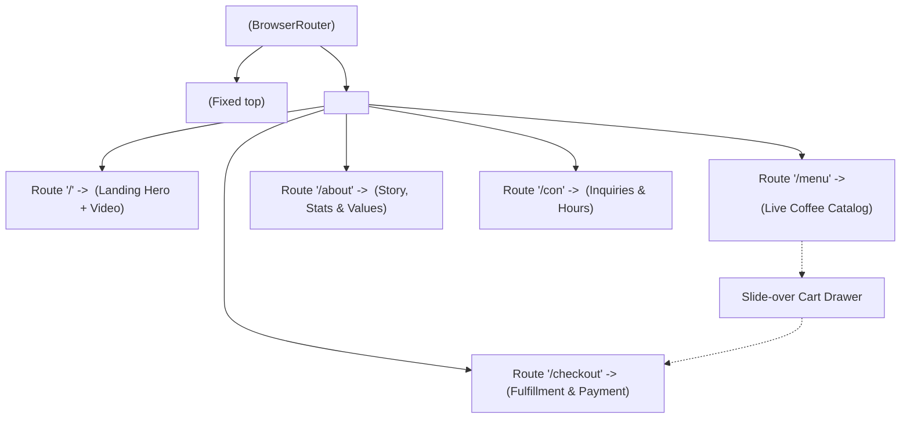

# ☕ Brew Umber — Frontend Client Application

> High-performance, responsive single-page web application (SPA) for **Brew Umber**, an artisanal specialty coffee brand and roastery. Crafted with React 19, Vite 8, Tailwind CSS v4, and React Router DOM.

---

## Table of Contents

- [Overview](#overview)
- [Architecture & Directory Structure](#architecture--directory-structure)
- [Component Hierarchy & Pages](#component-hierarchy--pages)
- [State Management & Cart Persistence](#state-management--cart-persistence)
- [Tech Stack & Libraries](#tech-stack--libraries)
- [API Integration & Error Handling](#api-integration--error-handling)
- [Environment Variables](#environment-variables)
- [Local Setup & Execution](#local-setup--execution)

---

## Overview

The `frontend` client provides an immersive digital café storefront. It enables users to explore artisanal hot and cold brews, inspect roast notes and ingredient profiles, maintain a persistent shopping cart, and complete orders through an interactive dual-fulfillment checkout flow (table-side service for dine-in or doorstep delivery for takeaway).

---

## Architecture & Directory Structure

```text
frontend/
├── public/
│   ├── apple-touch-icon.png
│   ├── favicon.ico
│   ├── favicon.png
│   ├── favicon.svg
│   ├── icons.svg
│   ├── qr.jpeg                 # Default UPI payment QR graphic
│   └── upi-qr.png
├── src/
│   ├── assets/                 # Video and image brand assets
│   │   ├── Beans.jpg           # Hero background image
│   │   ├── Caffe.png           # Brand circular badge logo
│   │   ├── coffee.mp4          # Artisanal brewing looping hero video
│   │   ├── hero.png            # Hero visual asset
│   │   ├── Logo.jpg            # Secondary logo
│   │   └── Pic.png             # Alternative brand graphic
│   ├── component/              # Modular UI components
│   │   ├── About.jsx           # Roastery narrative, stats, and values
│   │   ├── Checkout.jsx        # Dual-mode fulfillment and multi-payment checkout
│   │   ├── Contact.jsx         # Contact form and café information
│   │   ├── Left.jsx            # Brand identity navbar logo component
│   │   ├── Menu.jsx            # Coffee catalog with category filters & cart drawer
│   │   ├── Mpage.jsx           # Landing page with video hero section
│   │   ├── Navbar.jsx          # Responsive desktop & mobile hamburger navigation
│   │   ├── Npage.jsx           # Navbar wrapper container
│   │   └── Sign.jsx            # Authentication / registration scaffolding
│   ├── context/
│   │   └── CartContext.jsx     # Global shopping cart state & localStorage sync
│   ├── App.css                 # Custom animations and utilities
│   ├── App.jsx                 # Route table and top-level layout
│   ├── index.css               # Tailwind CSS v4 import directive
│   ├── main.jsx                # Application root mounting with CartProvider
│   └── rest.json               # Structured content data for About and values
├── .env                        # Frontend environment variables (ignored by Git)
├── .gitignore                  # Frontend Git exclusions
├── eslint.config.js            # ESLint rules and configuration
├── index.html                  # HTML entry document
├── package.json                # Frontend dependencies, scripts, and metadata
└── vite.config.js              # Vite 8 bundler and Tailwind CSS plugin setup
```

---

## Component Hierarchy & Pages

The application is structured into declarative routes inside [`src/App.jsx`](file:///e:/MERN/Brew-Umber-main/frontend/src/App.jsx):



### Page Breakdown
- **Landing Page ([`Mpage.jsx`](file:///e:/MERN/Brew-Umber-main/frontend/src/component/Mpage.jsx))**:
  Hero showcase featuring artisanal branding, call-to-actions, and an integrated, muted autoplay video (`coffee.mp4`) demonstrating manual coffee extraction.
- **Coffee Menu ([`Menu.jsx`](file:///e:/MERN/Brew-Umber-main/frontend/src/component/Menu.jsx))**:
  Fetches live catalog items from `https://api.sampleapis.com/coffee/hot` and `iced`. Enforces stable pricing via a deterministic string-hash function (`priceFor`). Includes real-time quantity steppers and a cart slide-over toggle.
- **Checkout ([`Checkout.jsx`](file:///e:/MERN/Brew-Umber-main/frontend/src/component/Checkout.jsx))**:
  - **Fulfillment Selection**:
    - **At Store**: Prompts for a mandatory table number for table-side delivery; zero delivery charge.
    - **At Home**: Prompts for full street address, city, and PIN code; automatically adds standard delivery charge (₹30).
  - **Payment Methods**:
    - **UPI**: Displays an in-app QR code (`/qr.jpeg`), guided payment steps, and a confirmation toggle.
    - **Credit / Debit Card**: Form fields with client-side validation for card number, expiration, and CVV.
    - **Cash on Delivery**: Sets payment status to `'pending'` for in-person settlement.
  - **Invoice Summary**: Real-time breakdown of items, subtotal, 5% tax, delivery, and gross total.
- **About ([`About.jsx`](file:///e:/MERN/Brew-Umber-main/frontend/src/component/About.jsx))**:
  Data-driven page consuming [`rest.json`](file:///e:/MERN/Brew-Umber-main/frontend/src/rest.json) to display the brand origin story, sustainable sourcing statistics, and ethical roasting values.
- **Contact ([`Contact.jsx`](file:///e:/MERN/Brew-Umber-main/frontend/src/component/Contact.jsx))**:
  Interactive contact form with real-time field validation, operating hours, and location information.

---

## State Management & Cart Persistence

The cart state is managed globally through [`CartContext.jsx`](file:///e:/MERN/Brew-Umber-main/frontend/src/context/CartContext.jsx).

### Features:
1. **Persistent LocalStorage**:
   The cart array automatically serializes to `localStorage` under the key `'brew-umber-cart'` on every state mutation.
2. **Multi-Tab Synchronization**:
   Listens to the native browser `window.addEventListener('storage')` event to synchronize item quantities and prices across multiple open tabs in real-time.
3. **Deterministic Price Guarantee**:
   Prices for external catalog items are assigned using a deterministic polynomial hash of each item's title:
   ```javascript
   const priceFor = (title = '') => {
     let h = 0
     for (const ch of title) h = (h * 31 + ch.charCodeAt(0)) >>> 0
     return String(150 + (h % 201))
   }
   ```
   This ensures that item prices remain identical across reloads, in cart drawers, and at final checkout.

---

## Tech Stack & Libraries

| Library | Version | Purpose |
| :--- | :--- | :--- |
| **React** | `^19.2.7` | UI library for functional component rendering |
| **Vite** | `^8.1.1` | Next-generation build tool & HMR development server |
| **Tailwind CSS** | `^4.3.3` | Utility-first styling via `@tailwindcss/vite` |
| **React Router DOM** | `^7.18.4` | Declarative client-side routing |
| **Remix Icon** | `^4.9.1` | Vector icon set for UI actions, cart, and payment logos |
| **Redux Toolkit** | `^2.12.0` | Global state management library installed for modular scaling |

---

## API Integration & Error Handling

### Configurable Backend Endpoint
The checkout component reads the backend order API endpoint dynamically from Vite environment variables:

```javascript
const ORDER_API_URL =
  import.meta.env.VITE_ORDER_API_URL || 'https://brew-umber.onrender.com/api/orders'
```

### Resilient JSON Response Parser (`readJsonResponse`)
To prevent client-side JavaScript crashes when free-tier backend hosts (such as Render) wake up from cold starts or return HTML error pages:

```javascript
const readJsonResponse = async (response) => {
  const contentType = response.headers.get('content-type') || ''
  if (!contentType.includes('application/json')) {
    if (response.ok || response.status === 404) {
      throw new Error('The order service did not respond correctly. Address may be misconfigured.')
    }
    throw new Error(`The order server is waking up or unavailable (error ${response.status}). Please try again.`)
  }
  return await response.json()
}
```

---

## Environment Variables

Create a `.env` file in the `frontend/` directory to customize API endpoints:

```env
# Optional: Override the backend orders API URL (e.g. for local development)
VITE_ORDER_API_URL=http://localhost:5000/api/orders
```

*If this variable is omitted, the frontend automatically falls back to the production API on Render.*

---

## Local Setup & Execution

### 1. Install Dependencies
```bash
cd frontend
npm install
```

### 2. Configure Environment (Optional)
Ensure `frontend/.env` is configured to target your local backend (`http://localhost:5000/api/orders`) or production.

### 3. Launch Development Server
```bash
npm run dev
```
The client will be accessible at:
```text
http://localhost:5173
```

### 4. Code Linting
```bash
npm run lint
```

### 5. Production Build & Preview
Compile optimized production assets and preview them locally:
```bash
npm run build
npm run preview
```
The optimized bundle will be generated into the `frontend/dist/` directory.
